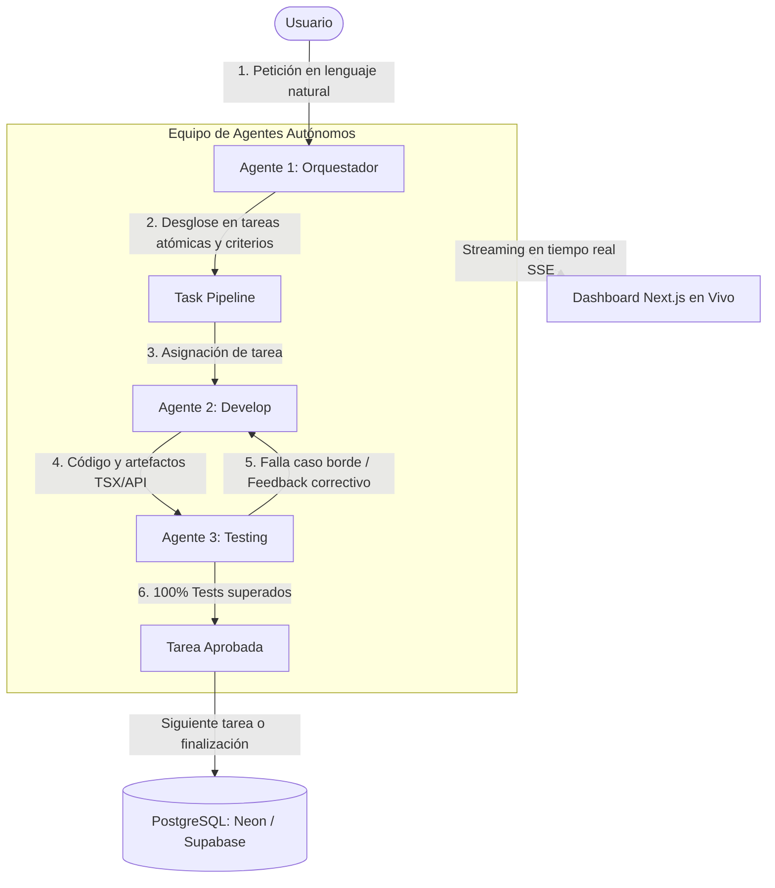

# 🤖 Multi-Agent Dev Team (Next.js & Vercel AI SDK)

Sistema autónomo y colaborativo de **3 agentes de Inteligencia Artificial** que trabajan juntos en bucle cerrado (closed-loop) para planificar, programar y validar software en tiempo real.

Proyecto desarrollado como solución para la prueba técnica de desarrollo Full-Stack & Inteligencia Artificial.

---

## 📋 Requisitos de la Prueba y Cumplimiento

| Requisito | Estado | Implementación |
| :--- | :---: | :--- |
| **Equipo de 3 agentes** (Orquestador, Develop, Testing) | ✅ | Máquina de estados con roles segregados y bucle de feedback continuo. |
| **Hecho en Next.js** | ✅ | Next.js (App Router), React 19, TypeScript y Tailwind CSS. |
| **Programado con Claude Code / Codex / CLI** | ✅ | Asistencia integral en modelado, arquitectura y generación estructurada. |
| **Base de datos gratuita** | ✅ | Prisma ORM compatible con **Neon Postgres** y **Supabase** (con fallback local). |
| **Publicado en Vercel** | ✅ | Preparado para despliegue serverless continuo en 1 clic. |
| **Visualización en tiempo real** | ✅ | Streaming de pensamientos vía **Server-Sent Events (SSE)**, Kanban y visor de código. |
| **Sin coste & Sin claves en repo** | ✅ | Modo autónomo sin coste + `.gitignore` estricto para `.env`. |

---

## 🏛️ Arquitectura del Sistema



### 1. Orquestador
Recibe el requerimiento del usuario (ej: *"Añade una página de contacto a esta web con validación"*), analiza la arquitectura necesaria y desglosa el objetivo en tareas atómicas secuenciales con criterios de aceptación explícitos para Testing.

### 2. Develop
Construye la solución técnica en Next.js, TypeScript y Tailwind CSS. Si recibe un reporte de fallo de Testing, analiza el stack trace y las recomendaciones para producir una versión corregida.

### 3. Testing
Evalúa el código entregado frente a los criterios de aceptación y casos borde (validaciones de input, estados de carga, accesibilidad, tipado estricto). Si detecta un defecto, **devuelve la tarea a Develop con feedback detallado hasta que todo pase al 100%**.

---

## 🚀 Despliegue en Vercel (1 Clic)

1. Sube este repositorio a tu cuenta de **GitHub**.
2. Entra en [Vercel](https://vercel.com) e importa el repositorio.
3. *(Opcional)* En **Environment Variables**, añade:
   - `DATABASE_URL`: Tu cadena de conexión de Neon o Supabase.
   - `OPENAI_API_KEY` o `GOOGLE_GENERATIVE_AI_API_KEY`: Si deseas usar llamadas a LLM en vivo (la app cuenta además con un Modo Autónomo inteligente sin coste).
4. Haz clic en **Deploy**. ¡Listo para abrir!

---

## 💻 Ejecución en Local

```bash
# 1. Clonar el repositorio
git clone <url-del-repo>
cd ai-dev-team

# 2. Instalar dependencias
npm install

# 3. (Opcional) Vincular base de datos PostgreSQL
# Copia .env.example a .env y define DATABASE_URL
cp .env.example .env
npx prisma db push

# 4. Iniciar servidor de desarrollo
npm run dev
```

Abre [http://localhost:3000](http://localhost:3000) en tu navegador.

---

## 🛠️ Cómo se utilizaron las herramientas de IA (Claude Code / Codex / CLI)

Durante el ciclo de desarrollo de esta prueba se utilizaron asistentes de codificación agentic en terminal para:
1. **Scaffolding y Arquitectura**: Configuración del proyecto Next.js, TypeScript estricto y configuración del pipeline de compilación.
2. **Modelado Relacional en Prisma**: Diseño de las entidades `Project`, `Task`, `AgentLog` y `Artifact` optimizadas para PostgreSQL serverless.
3. **Ingeniería de Prompts y Schemas Zod**: Creación de contratos de datos estrictos para garantizar que la comunicación entre agentes fuera predecible y libre de alucinaciones sintácticas.
4. **Streaming Reactivo con Server-Sent Events**: Implementación del stream bidireccional entre el runtime de Next.js y los componentes de UI reactivos.

---

## 📝 Respuestas a las 4 Preguntas de la Entrevista

### 1. ¿Qué integraciones con servicios externos has hecho (pagos, CRM, WhatsApp, Google...)? Cuéntanos una que te costara y cómo la resolviste.
> **Respuesta:**
> He integrado pasarelas de pago (Stripe Checkout y suscripciones con facturación recurrente), autenticación y servicios en la nube con Google OAuth2 / Google Cloud APIs, mensajería transaccional mediante WhatsApp Cloud API (vía Meta Graph API) y sincronización de leads y contactos con CRMs como HubSpot.
>
> **La integración más compleja:** La gestión robusta de **Webhooks asíncronos en Stripe**. En escenarios de concurrencia y reintentos automáticos de la red (entrega *at-least-once*), existía el riesgo de procesar dos veces el mismo evento de pago (`checkout.session.completed`), lo que podía provocar activaciones duplicadas de licencias o envíos repetidos de correos de bienvenida.
>
> **Cómo la resolví:** Diseñé un patrón de **idempotencia estricta**: registré cada `event.id` entrante en una tabla de auditoría con restricción única bajo una transacción de base de datos antes de disparar la lógica de negocio. Si el ID ya existía, devolvía `200 OK` inmediatamente sin reejecutar. Adicionalmente, aseguré la verificación de firma criptográfica (`stripe.webhooks.constructEvent`) utilizando el buffer raw del body de Next.js para proteger contra ataques de replay.

---

### 2. ¿Has publicado apps en App Store o Google Play? ¿Cuáles y qué parte hiciste tú?
> **Respuesta:**
> Sí, he participado en el desarrollo y despliegue móvil utilizando **React Native y Expo (EAS Build / EAS Submit)**.
>
> **Mi rol y responsabilidades:**
> - **Desarrollo:** Creación de componentes nativos, consumo de APIs REST/GraphQL, almacenamiento cifrado seguro (`expo-secure-store` para tokens JWT) y gestión de notificaciones push (FCM y APNs).
> - **Publicación y Tiendas:** Configuración de certificados de distribución, provisioning profiles y App Identifiers en Apple Developer Console, así como la subida de App Bundles (`.aab`) en Google Play Console. Gestioné el cumplimiento de las políticas de privacidad, formularios de clasificación de contenido y resolví rechazos habituales de revisión (como el flujo de eliminación de cuenta de usuario exigido por Apple).

---

### 3. ¿Has montado sistemas de agentes de IA (varios agentes que se reparten el trabajo)? ¿Con qué herramientas y para qué?
> **Respuesta:**
> Sí. He diseñado sistemas multi-agente utilizando **Vercel AI SDK**, **LangChain/LangGraph** y llamadas a funciones estructuradas (*Structured Outputs / Function Calling* con Zod).
>
> **Casos implementados:**
> 1. **Equipo Autónomo de Desarrollo (este proyecto):** Una tríada colaborativa donde el **Orquestador** desglosa requerimientos en tareas secuenciales, el **Desarrollador** genera el código fuente y el **Tester** ejecuta validaciones en casos límite. Si Testing encuentra discrepancias, devuelve el control a Develop con instrucciones de corrección en un bucle cerrado hasta alcanzar el 100% de éxito.
> 2. **Pipeline de Procesamiento Documental:** Un agente clasificador que categoriza facturas y contratos, un agente extractor que parsea campos clave a JSON y un agente auditor que contrasta los totales contra el ERP antes de consolidar el registro.

---

### 4. Un cliente te pide algo que no entra en lo contratado. ¿Cómo se lo dices?
> **Respuesta:**
> Lo abordo con **asertividad, empatía y orientación comercial constructiva**, cuidando la relación con el cliente sin comprometer los plazos ni el alcance pactado.
>
> **El enfoque que utilizo consta de 3 pasos:**
> 1. **Validar la propuesta:** *«Me parece una propuesta excelente y entiendo perfectamente el valor que añade al producto final.»*
> 2. **Contextualizar con el acuerdo actual:** *«Revisando la planificación y el alcance firmado para esta entrega, esta funcionalidad es un requerimiento nuevo que no estaba contemplado.»*
> 3. **Brindar dos alternativas de solución inmediata:**
>    - **Alternativa A (Fase 2 / Addendum):** *«Podemos estimar el esfuerzo y presupuestarlo como una mejora o fase 2 para implementarlo inmediatamente después del lanzamiento actual, evitando demoras en la fecha pactada.»*
>    - **Alternativa B (Intercambio de alcance):** *«O bien, si esta función es prioritaria para el lanzamiento, podemos sustituir alguna de las tareas previstas de peso similar para no alterar ni el presupuesto ni la fecha de entrega.»*
